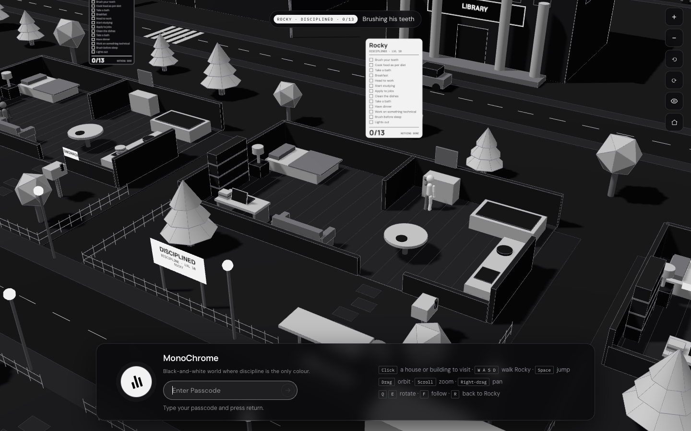
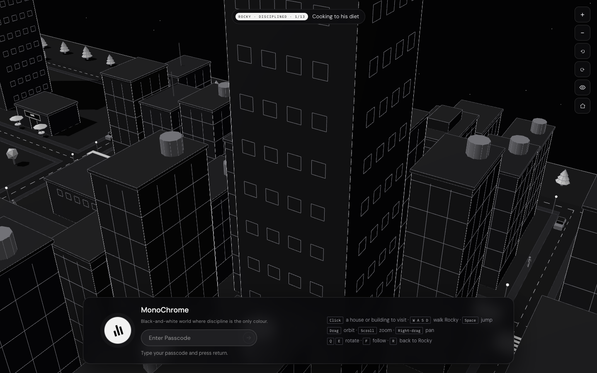
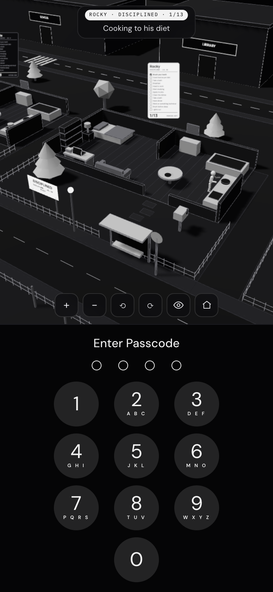
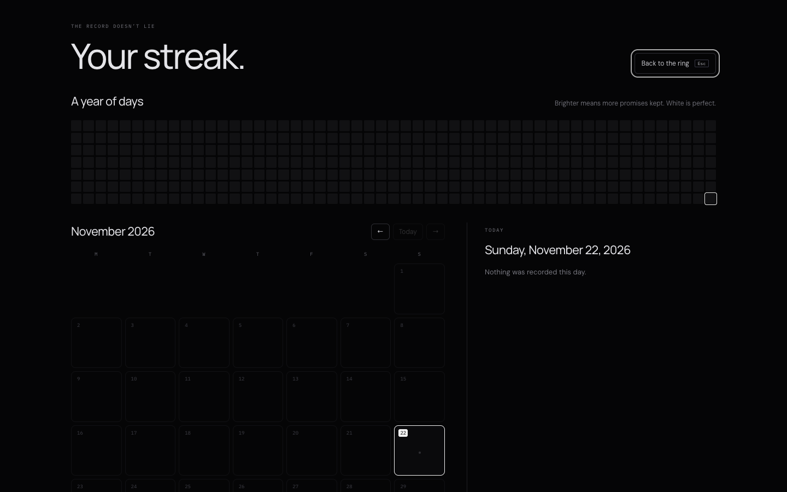

# MonoChrome

[](https://github.com/Yaswanth2120/monochrome/actions/workflows/ci.yml)
[](LICENSE)


**Black-and-white world where discipline is the only colour.**

MonoChrome is a 3D habit tracker built to keep a daily routine honest. You don't tick boxes in a list: you commit to each task by holding a key, the day only moves forward in order, and a black-and-white world records every promise you keep or break.



## The lock screen: a living neighbourhood

The site opens on a lock screen that is also a small 3D city. **Rocky**, the disciplined one, lives in the middle of it and works through the whole routine every day while his checklist fills up to 13/13. His five neighbours live the same day badly:

| House sign             | Resident | How they spend the day                                        |
| ---------------------- | -------- | ------------------------------------------------------------- |
| DISCIPLINED · LVL 10   | Rocky    | Does every task in order, catches the bus, lights out on time |
| PROCRASTINATOR · LVL 3 | Ferris   | Walks up to a task, turns back to the sofa, panics at night   |
| DISTRACTED · LVL 2     | Gollum   | Starts something, then the phone buzzes                       |
| LAZY · LVL 1           | Lebowski | Snooze, fridge, couch, bed                                    |
| SCATTERED · LVL 4      | Flash    | Starts everything at triple speed and finishes nothing        |
| PERFECTIONIST · LVL 5  | Nina     | Ticks a box, decides it wasn't perfect, unticks it            |

Around them is a full city. It has a school, a library, an office tower, a café, a hospital, police and fire stations, a grocery, a gym and a park. Downtown has City Hall, a Bank, a Mall, a Cinema, a Hotel and the Skyline Tower, and the west side has the Maple Row suburb and a stadium. About 50 vehicles drive the roads, including buses, police cars and ambulances with blinking lights, and pedestrians walk the pavements.




- **Click** a house or building to fly to it. Use **← Back to Rocky** or **R** to come home.
- **Drag** to orbit, **scroll** or pinch to zoom, **right-drag** to pan, **Q / E** to rotate, **F** to follow.
- **WASD** walks Rocky and **Space** jumps. He goes back to his routine after a few seconds.
- On computers the passcode panel is Mac-style. Tablets and phones get an iPad- or iPhone-style keypad.

<p align="center"></p>

## The routine world

After unlocking, the day is a ring of islands, one per task in your routine, in a monochrome solar-system world.


- **Hold to commit.** Hold **E** (or the button) to complete a task. Tasks unlock strictly in order, so you can't skip ahead.
- **Steps, counters and bonuses.** A task can be a list of steps (like breakfast) or a counter with a goal and a stretch (like "reach out to 3–5 people"). Bonus tasks are optional and shine brighter.
- **Time windows.** A task can have one, like lights out (9–11:30 PM in the sample routine). It can only be committed inside the window.
- **Vows.** Promises like "no phone in bed" are held all day and sealed at night. An honest **I slipped** button records a broken vow.
- The day rolls over at 4 AM.
- Sound effects are generated with Web Audio. **M** mutes them, **H** hides the task dock, **L** locks the screen, and the zoom controls work anywhere in the world.

## Settings: make the routine yours

Press **,** or the ⚙ button to open Settings.

- **Routine:** add, edit, delete and reorder tasks (drag, or use the arrows). Each task has:
  - a name, a short label and a description;
  - a type: hold to commit, steps, or a counter with a goal and a stretch;
  - a bonus flag and an optional time window;
  - an icon.
- **Vows:** add, rename, reorder or remove them, and choose when each can be sealed at night.
- **Account:** change your passcode, or sign out.
- **Preferences:** sound and the keyboard reference.

Edits are saved as a draft first. Once you've done anything today, saved changes start **tomorrow at 4 AM**, so a skipped task can't be deleted to rescue the day. Before then you can choose **Apply now**. Each day's score is frozen when it's saved, so editing the routine never rewrites past days.

## Streak calendar

Press **C** to see the record: a year-of-days heatmap, a month grid with the details of each day, and a dashboard with streaks and 30-day consistency.



## Tech

- React 19, TypeScript and Vite
- three.js for both 3D worlds. Everything is built in code from boxes, lines and canvas-drawn signs, with no 3D model files.
- Tailwind CSS v4 plus hand-written CSS
- Firebase: Google sign-in, Firestore with live sync and an offline cache, and Hosting. Builds without Firebase config fall back to local-only mode with `localStorage`.

## Getting started

You need Node 22 and pnpm 10 (the exact versions are pinned in `.mise.toml`).

```bash
pnpm install
pnpm dev      # http://localhost:8443
pnpm build    # static site in dist/
```

| Script           | What it does                                                |
| ---------------- | ----------------------------------------------------------- |
| `pnpm dev`       | Start the dev server with hot reload                        |
| `pnpm build`     | Build the static site into `dist/`                          |
| `pnpm typecheck` | Type-check with TypeScript                                  |
| `pnpm lint`      | Lint with oxlint                                            |
| `pnpm format`    | Format everything with oxfmt                                |
| `pnpm check`     | Everything CI runs: typecheck, lint, format check and build |

### Firebase (optional)

Accounts and sync run on Firebase: Auth for Google sign-in, Firestore for data, Hosting for the site. To connect your own project, copy `.env.example` to `.env.local` and fill in your web app config. Without it, MonoChrome runs in local-only mode and keeps data in the browser.

- `firestore.rules` holds the security rules. Deny by default, and users can only read and write their own data.
- `firebase.json` and `.firebaserc` hold the Hosting and Firestore config for the `monochrome-y` project.
- Every merge into `main` deploys to Firebase Hosting through `.github/workflows/deploy.yml`.

To work on accounts without touching the real project, run the local emulators (Java required):

```bash
pnpm emulators        # Auth on :9099, Firestore on :8080
pnpm dev:emulators    # the app, signed in against the emulators
```

## Project layout

```
src/
  App.tsx           routine dock, hold-to-commit, keyboard controls
  World.tsx         the routine ring world
  Calendar.tsx      streak calendar and dashboard
  LockScreen.tsx    passcode gate (desktop panel / touch keypad)
  LockScene.tsx     the 3D city scene and camera
  routine.ts        routine model, default routine, timing rules, scoring, validation
  Settings.tsx      settings page and routine editor
  lib/              Firebase client, account, passcodes, routine and history sync
  sound.ts          synthesized sound effects
  figure.ts         the pictogram character rig and poses
  town/             city kit, houses, residents, roads, traffic, pedestrians
```

## Roadmap

- A routine editor, so anyone can build their own list of tasks and vows.
- Neighbourhoods with friends: real people move into the houses and their boards update live.

See [CHANGELOG.md](CHANGELOG.md) for what has shipped.

## Contributing

Contributions are welcome. Read [CONTRIBUTING.md](CONTRIBUTING.md) for the branch, commit and pull request conventions, and follow the [Code of Conduct](CODE_OF_CONDUCT.md). To report a security issue, see [SECURITY.md](SECURITY.md).

## License

[MIT](LICENSE) © 2026 Yaswanth2120
